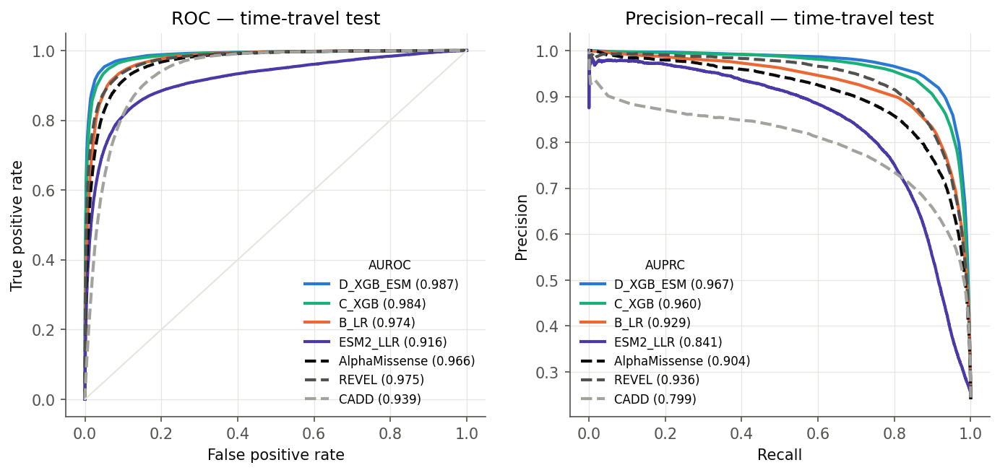
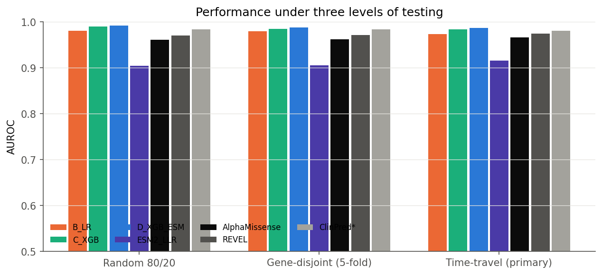
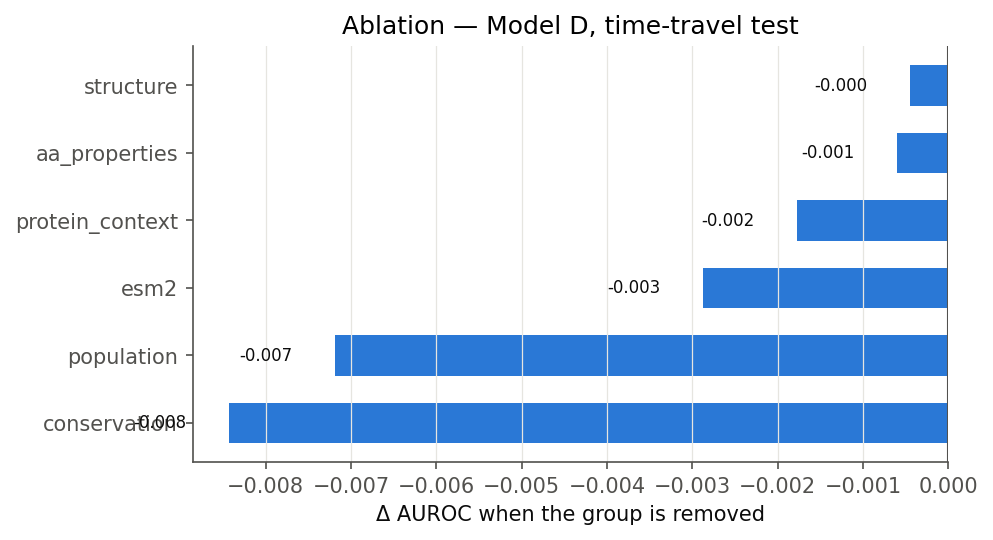
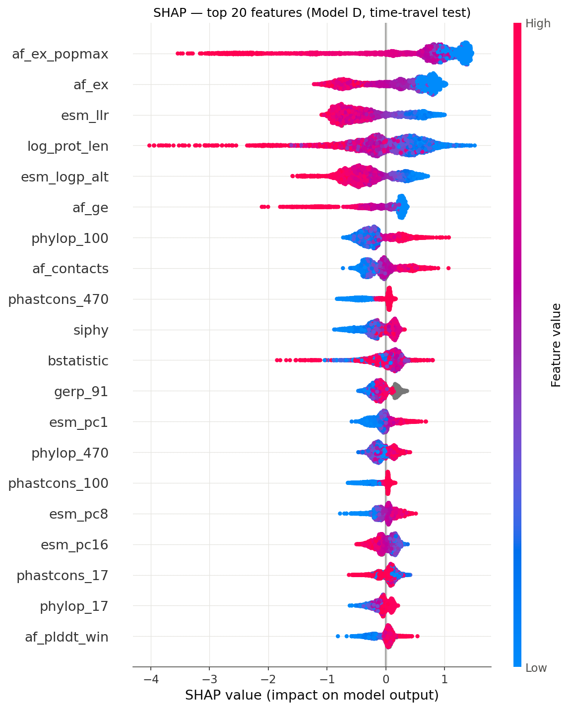
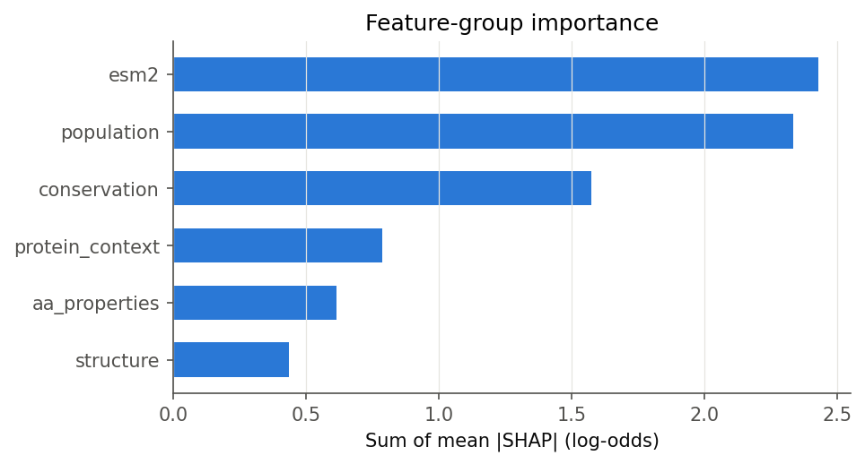
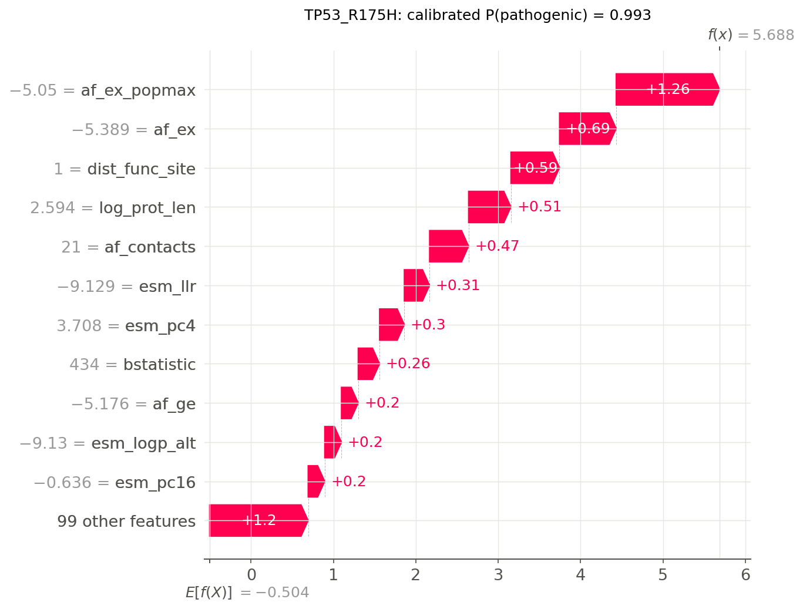
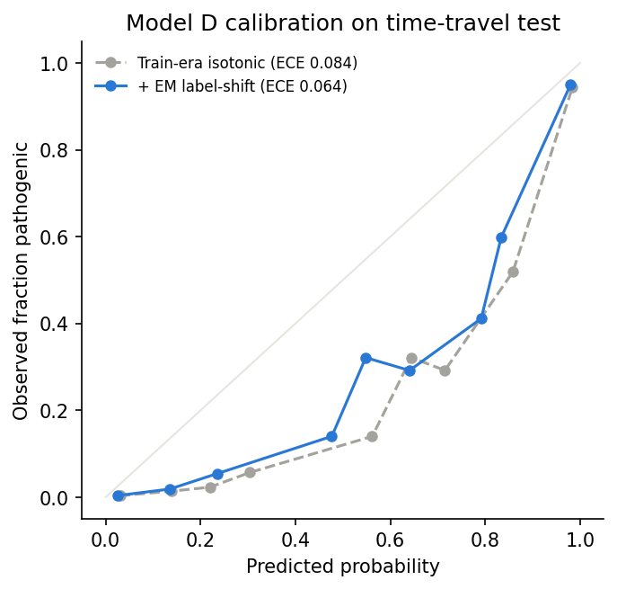

# Leakage-Controlled Missense Pathogenicity Prediction: Mid-term Technical Report

**B.Tech Major Project, IIIT Nagpur (ECE).** Piyush Gupta, Om Tilwar, Varun Tripathi.
Guide: Dr. Nikhil Dhengre. Report date: 5 Oct 2026. Mid-term presentation: 7 Oct 2026.

---

## 1. Summary

The full pipeline is built, trained and evaluated. Our best model (D: XGBoost + ESM-2) reaches
**AUROC 0.987** on the primary time-travel test, ahead of REVEL (0.975) and AlphaMissense (0.966).
The proposal deck's plan is fully implemented.

- **Goal:** predict whether a rare missense variant is pathogenic or benign from biological evidence alone.
  - ClinVar is used only as the label.
  - Performance is measured on variants the model could not have seen.
- **Data:** two ClinVar releases.
  - Jan 2023 (91,261 labelled missense variants) is the training era.
  - Sep 2026 (202,015) supplies 124,139 variants labelled later, which form the time-travel test.
- **Features:** 6 groups, 90 features (110 with ESM-2):
  - population frequency
  - conservation
  - protein context
  - AlphaFold structure
  - amino-acid properties
  - ESM-2 protein language model
- **Models:** logistic regression (B), XGBoost (C), and XGBoost + ESM-2 (D), each with isotonic calibration.
  Eight published tools are scored as baselines.
- **Testing:** random 80/20, gene-disjoint 5-fold, and time-travel (primary).
  Rare-variant and new-gene subsets are reported separately.
- **Replications:**
  - Brandes 2023 (protein language model score): reproduced.
  - Grimm 2015 (circularity): demonstrated.
  - Pejaver 2022 (evidence thresholds): partly reproduced.
- **Honest limits:**
  - Probabilities become over-confident on later variants.
  - The weakest pathogenic evidence levels fail validation.
  - Genes never seen in training are the hardest case.

*Research use only. The model does not give a clinical diagnosis or a final variant classification.*

---

## 2. Trained models

Yes, four trained models are saved in `results/models/` (listed in `manifest.json`).
The three `_temporal` models produced every time-travel number in this report.
The `_final` model is the one to use for the demo.

| File | Model | Trained on | Training variants | Features | Size |
| --- | --- | --- | --- | --- | --- |
| `B_LR_temporal.joblib` | B: logistic regression (median imputation + standardisation) | ClinVar 2023-01 | 91,261 | 90 | 0.01 MB |
| `C_XGB_temporal.joblib` | C: XGBoost, 700 trees, depth 6 | ClinVar 2023-01 | 91,261 | 90 | 2.1 MB |
| `D_XGB_ESM_temporal.joblib` | D: XGBoost + ESM-2 (4 scores + 16 embedding PCs) | ClinVar 2023-01 | 91,261 | 110 | 2.2 MB |
| `D_XGB_ESM_final.joblib` | D, retrained on all current labels | ClinVar 2026-09 | 202,015 | 110 | 2.5 MB |

Each file contains:
- the classifier itself;
- the isotonic calibrator, fit on a gene-disjoint 15% hold-out;
- the ESM-2 PCA projection, fit on training rows only;
- the feature list and training metadata.

The XGBoost models are also exported as portable `*_booster.json` files.

ESM-2 650M is used frozen, not fine-tuned. Its weights are in `models/esm2_t33_650M_UR50D/` (2.6 GB).

**How to use:**

```
python src/predict.py "chr17:g.7675088C>T"
python src/predict.py "chr17:g.7675088C>T" --model D_XGB_ESM_temporal
```

The tool computes every feature live and prints three things:
- the calibrated probability;
- the ClinGen PP3/BP4 evidence level;
- the top SHAP reasons.

For TP53 p.R175H, the final model returns P = 0.985 (PP3_Strong). The time-travel model gives 0.993.

---

## 3. Data

The dataset holds 215,400 unique GRCh38 missense variants. Each has a confident ClinVar label in at least one of the two releases.

**Label rules** (`src/01_build_clinvar.py`):

- **Variant type:** single-nucleotide variants whose HGVS protein change is missense (p.Xxx123Yyy, not stop, not synonymous).
- **Labels:**
  - 1 = Pathogenic, Likely pathogenic, or Pathogenic/Likely pathogenic.
  - 0 = Benign, Likely benign, or Benign/Likely benign.
- **Dropped:** VUS, conflicting and other classes.
- **Review status:** at least 1 star (criteria provided). Conflicting-interpretation statuses are excluded.

| | ClinVar 2023-01 (train era) | ClinVar 2026-09 (latest) |
| --- | --- | --- |
| Labelled missense variants | 91,261 | 202,015 |
| Pathogenic / LP | 35,243 (38.6%) | 61,611 (30.5%) |
| Benign / LB | 56,018 | 140,404 |
| Genes | 8,199 | 15,264 |

| Evaluation subset | Variants | Pathogenic | Definition |
| --- | --- | --- | --- |
| Time-travel test | 124,139 | 30,333 (24.4%) | Labelled in 2026-09, not labelled in 2023-01 |
| Time-travel, rare | 71,570 | 28,545 | gnomAD max AF below 1e-4, or absent |
| Time-travel, new genes | 26,268 | 405 | Gene had no labelled variant in 2023-01 |
| Time-travel, rare + new genes | 10,889 | 356 | Both conditions |

Only 15 variants flipped between pathogenic and benign across the two releases, so the labels are stable.

**Raw sources:**

| Source | Used for |
| --- | --- |
| ClinVar `variant_summary` (NCBI FTP: 2023-01 archive and 2026-09 current) | Labels |
| UniProt Swiss-Prot human proteome (20,431 proteins) | Sequences and annotations |
| MyVariant.info | gnomAD and dbNSFP fields |
| AlphaFold DB v6 | Structures |

---

## 4. Features

Models B and C use 90 biological features. Model D adds 20 ESM-2 features, for 110 in total.
No ClinVar-derived value, and no published predictor score, is ever a feature.

| Group | Features | Source | Coverage |
| --- | --- | --- | --- |
| Population frequency (8) | gnomAD exome and genome AF (log10), popmax AF across ancestries, homozygote counts, presence flags | gnomAD via MyVariant.info | 100% (absent = AF 0) |
| Conservation (9) | phyloP 17/100/470-way, phastCons 17/100/470-way, GERP 91-mammal, SiPhy, B-statistic | dbNSFP via MyVariant.info | 99.9% |
| Protein context (17) | relative position, log protein length, InterPro domain, distance to an active/binding site, 13 UniProt site/region flags | UniProt, dbNSFP | 93% |
| Structure (3) | AlphaFold pLDDT at the residue, mean pLDDT ±5 residues, Cα contacts within 10 Å (burial) | AlphaFold DB v6 | 81% |
| Amino-acid properties (53) | Grantham, BLOSUM62, Δhydropathy, Δvolume, Δpolarity, Δcharge, aromatic change, Pro/Gly/Cys flags, ref/alt one-hot | Computed | 100% |
| ESM-2 (4 + 16 PCs) | log-likelihood ratio, log p(ref), log p(alt), position entropy, 16 PCA components of the residue embedding | ESM-2 650M, run locally | 93% |

The 13 UniProt flags are: domain, active site, binding site, disulfide, transmembrane, signal peptide, PTM, zinc finger, motif, helix, strand, region, and low complexity.

**Missing values:** XGBoost handles them natively. Logistic regression imputes the median and adds missing-value indicators.

**ESM-2 scoring:**

- One forward pass per protein window gives the probabilities of all 20 amino acids at every residue (wild-type marginals).
- Proteins longer than 1,022 residues are tiled with 50% overlap. Each residue uses the window in which it is most central.
- Scoring 14,808 proteins (200,254 variants) took about 40 minutes on the RTX 4050.

**Baselines are kept apart.** Their columns are prefixed `bl_` and are never used as features.
- Scored as baselines: AlphaMissense, REVEL, CADD, ESM1b, PrimateAI.
- Also scored, but marked as circular because they were trained on ClinVar: ClinPred, MetaRNN, VARITY.

---

## 5. Leakage control and evaluation design

Every model is tested three ways, from optimistic to strict. The time-travel test gives the headline number.
It mimics real use: predicting variants before experts have classified them.

| Test | Train | Test | What it rules out |
| --- | --- | --- | --- |
| Random 80/20 | 80% of 2026 labels (stratified) | 20% held out (40,403) | Nothing; optimistic reference |
| Gene-disjoint, 5-fold | 4/5 of genes | Remaining genes (all 202,015 scored out-of-fold) | Gene-level memorisation (Grimm type-2 circularity) |
| **Time-travel (primary)** | All 2023-01 labels (91,261) | 124,139 variants labelled after 2023-01 | Seeing the answer before experts did (type-1 circularity) |

**Pipeline**

ClinVar supplies only the labels. Every model input is biological evidence.

```
 ClinVar 2023-01  ───────────────►  Training set     ───────────►  MODEL D
 (labels only)                      91,261 variants                XGBoost + ESM-2 + isotonic
                                         ▲                               │
 Feature sources ── same features ───────┤                               │ scores
 gnomAD, phyloP, GERP,                   ▼                               ▼
 UniProt, AlphaFold, ESM-2          Time-travel test ───────────►  EVALUATION
                                    124,139 variants               AUROC, ECE, PP3/BP4
 ClinVar 2026-09  ───────────────►       ▲                               ▲
 (only labels added later)  ─────────────┘                               ┆ compared only
                                                                 Published tools (baselines)
```

**Leakage rules enforced in code:**

1. ClinVar is used only as the target, never as an input.
2. Published predictor scores are baselines only, never features.
3. Time-travel training uses the 2023 label, even when that variant's label changed later.
4. The ESM-embedding PCA and the isotonic calibrator are fit on training data only.
   The calibrator uses a gene-disjoint 15% hold-out.
5. Gene-disjoint folds use GroupKFold by gene symbol.

**Metrics:**

| Metric | What it measures |
| --- | --- |
| AUROC | Ranking |
| AUPRC | Ranking under class imbalance |
| Brier score | Probability accuracy |
| ECE (15 bins) | Calibration error |
| 95% CI | 1,000 bootstrap resamples (300 for the random and gene tests) |
| Ablation | Remove, or keep only, one feature group at a time |
| SHAP | Global and per-variant explanation (TreeSHAP, Lundberg 2020) |

---

## 6. Main results

On the time-travel test, Model D (AUROC 0.987, AUPRC 0.967) beats every published tool not trained on ClinVar.
Its confidence interval does not overlap those of REVEL (0.975) or AlphaMissense (0.966).

**Time-travel test, all 124,139 variants (95% bootstrap CI):**

| Rank | Method | AUROC (95% CI) | Note |
| --- | --- | --- | --- |
| 1 | **D: XGBoost + ESM-2 (ours)** | **0.987 (0.986–0.987)** | |
| 2 | MetaRNN* | 0.985 (0.984–0.985) | circular |
| 3 | C: XGBoost (ours) | 0.984 (0.983–0.985) | |
| 4 | ClinPred* | 0.980 (0.980–0.981) | circular |
| 5 | REVEL | 0.975 (0.974–0.976) | best published non-circular tool |
| 6 | B: Logistic regression (ours) | 0.974 (0.973–0.975) | |
| 7 | VARITY* | 0.974 (0.973–0.975) | circular |
| 8 | AlphaMissense | 0.966 (0.965–0.967) | |
| 9 | ESM1b | 0.940 (0.939–0.942) | |
| 10 | CADD | 0.939 (0.938–0.940) | |
| 11 | ESM-2 zero-shot (ours) | 0.916 (0.914–0.919) | |
| 12 | PrimateAI | 0.890 (0.888–0.892) | |

\* Trained on ClinVar labels, so the score is circular and not a fair comparison.



Our models barely degrade from the optimistic test to the strict one. The features describe the variant, not which gene it is in.

| Model | Random 80/20 | Gene-disjoint | Time-travel | Time-travel Brier |
| --- | --- | --- | --- | --- |
| B: Logistic regression | 0.981 | 0.980 | 0.974 | 0.087 |
| C: XGBoost | 0.990 | 0.985 | 0.984 | 0.065 |
| D: XGBoost + ESM-2 | 0.992 | 0.988 | 0.987 | 0.052 |



**Subsets** (time-travel test, AUROC / AUPRC):

| Subset | Variants (pathogenic) | Model D | REVEL | AlphaMissense |
| --- | --- | --- | --- | --- |
| Rare variants (AF < 1e-4) | 71,570 (28,545) | **0.983 / 0.975** | 0.973 / 0.961 | 0.963 / 0.939 |
| Genes unseen in 2023 | 26,268 (405) | 0.973 / **0.813** | 0.979 / 0.646 | **0.986** / 0.759 |
| Rare and unseen genes | 10,889 (356) | 0.988 / 0.865 | 0.984 / 0.858 | **0.990 / 0.890** |
| All tools scored (fair head-to-head) | 102,384 (25,858) | **0.987 / 0.968** | 0.977 / 0.940 | 0.967 / 0.909 |

- **Rare variants:** Model D keeps its lead, so it is not just using the "common means benign" shortcut.
- **Genes never labelled before:** this is our weak spot.
  - AlphaMissense ranks better by AUROC, though Model D still has the best AUPRC among non-circular tools.
  - With only 405 pathogenic variants in this subset, the differences are less stable.

---

## 7. Paper replications

We re-ran the key experiment of three papers from the literature survey.
Two replicate cleanly. One matches in shape but not in exact values.

| Paper | What we re-ran | Our result | Verdict |
| --- | --- | --- | --- |
| Brandes et al. 2023, *Nat Genet* (ESM1b) | Zero-shot protein language model log-likelihood ratio, wild-type marginals, sliding windows, using ESM-2 650M | AUROC 0.906 on all 2026 ClinVar missense; 0.916 on time-travel. dbNSFP's ESM1b gets 0.933 on the same data | **Reproduced**: strong zero-shot signal; the larger ESM1b is slightly better |
| Grimm et al. 2015, *Hum Mutat* (circularity) | AUROC on variants already in ClinVar 2023 vs. variants labelled later | ClinPred and MetaRNN (ClinVar-trained) **lose** 0.006 / 0.005. Every tool not trained on ClinVar **gains** 0.017–0.041 | **Demonstrated**: ClinVar-trained tools look inflated on old variants |
| Pejaver et al. 2022, *AJHG* (PP3/BP4 calibration) | Local-posterior thresholds for REVEL, prior 0.0441, OddsPath 2.406^k | PP3 0.732 / 0.854 / 0.982 and BP4 0.406 / 0.271 / 0.081 (published: 0.644 / 0.773 / 0.932 and 0.290 / 0.183 / 0.016) | **Partial**: same structure, stricter pathogenic cut-offs |

**Why the REVEL thresholds differ:**
- Pejaver used ClinVar 2019 and removed REVEL's own training variants. We used ClinVar 2023 rare variants.
- Our sliding window and bootstrap settings are simplified.
- The published thresholds still meet every likelihood-ratio target on our time-travel set.

**Why the Grimm result runs the "wrong" way for most tools:**
- Later ClinVar submissions are easier on average, so honest tools improve on them.
- ClinPred and MetaRNN get worse because they partly memorised the 2023 labels.
- The gap between the two groups (0.02–0.05 AUROC) is the circularity effect.

---

## 8. Ablation and interpretability

Conservation and population frequency carry the most information that no other group can replace.
ESM-2 is the strongest group on its own.

| Feature group | AUROC with group removed (change) | AUROC with this group alone | Alone, rare variants only |
| --- | --- | --- | --- |
| Conservation | 0.978 (−0.008) | 0.926 | 0.924 |
| Population frequency | 0.980 (−0.007) | 0.860 | 0.756 |
| ESM-2 | 0.984 (−0.003) | 0.946 | 0.948 |
| Protein context | 0.985 (−0.002) | 0.854 | 0.856 |
| Amino-acid properties | 0.986 (−0.001) | 0.768 | 0.764 |
| Structure (AlphaFold) | 0.986 (−0.000) | 0.778 | 0.781 |

All runs use Model D on the time-travel test, where the full model scores 0.987.

- **Population frequency:** falls from 0.860 to 0.756 on rare variants.
  - Much of its power is the "common means benign" rule (ACMG BA1/BS1), which curators also apply.
  - That is why rare variants are reported separately.
- **ESM-2 as features vs. zero-shot:** ESM-2 used as features (0.946) beats the zero-shot ESM-2 score (0.916). Supervised learning adds value on top of the language model.
- **Structure and amino-acid properties:** they carry signal alone (about 0.78), but are almost fully redundant once ESM-2 and conservation are present.



**SHAP findings** (TreeSHAP on 4,000 time-travel variants):

1. **Top features, in order:**
   1. gnomAD popmax AF
   2. gnomAD exome AF
   3. ESM-2 LLR
   4. protein length
   5. ESM-2 log p(alt)
   6. gnomAD genome AF
   7. phyloP-100
   8. AlphaFold contact density
2. **Directions are biologically sensible:** rare, conserved, buried and low-likelihood variants are pushed toward pathogenic.
3. **Protein length is a warning sign:**
   - Long proteins push toward benign, so length acts as a gene-identity proxy (genes like TTN have many benign variants).
   - This is a mild form of Grimm's type-2 circularity. We report it as a known bias.
4. **Worked example, TP53 p.Arg175His:** P = 0.993, PP3_Strong.
   - Reasons: absent from gnomAD, 1 residue from a UniProt functional site, 21 Cα contacts (buried), ESM-2 LLR −9.1.
   - This variant was in the training data, so it demonstrates the explanation, not the accuracy.







---

## 9. Calibration and evidence strength

Probabilities are well calibrated within one ClinVar era but over-confident on later variants.
A correction we added recovers about a quarter of the gap. This is our main negative result, and we present it openly.

| Model D | Brier score | ECE |
| --- | --- | --- |
| Random split (same era) | 0.030 | 0.015 |
| Gene-disjoint (same era) | 0.035 | 0.004 |
| Time-travel, calibrated on 2023 data | 0.052 | 0.084 |
| Time-travel + EM label-shift correction (our addition) | 0.044 | 0.065 |

- **Cause 1, the class balance shifted:**
  - 38.6% of 2023 labels are pathogenic, against 24.4% of later ones.
  - The Saerens EM method re-estimates the new balance from unlabelled predictions only and rescales them (`src/06b_label_shift.py`).
- **Cause 2, more than class balance:**
  - EM estimates a prior of 0.31, but the true value is 0.24.
  - Predictions between 0.5 and 0.85 remain too high.
  - Later variants are harder in ways the model has not seen.



**ClinGen PP3/BP4 evidence thresholds for Model D**

Thresholds were learned on gene-disjoint out-of-fold scores from the 2023 era, using Pejaver's method.
They were then checked on the time-travel test.

| Evidence level | Score range | Share of test variants | Realised LR | Target | Passes? |
| --- | --- | --- | --- | --- | --- |
| PP3 Strong | P ≥ 0.951 | 22.2% (holds 86% of pathogenic) | 59.3 | ≥ 33.5 | Yes |
| PP3 Moderate | 0.836–0.951 | 3.1% | 3.7 | ≥ 5.79 | **No** |
| PP3 Supporting | 0.667–0.836 | 1.9% | 1.3 | ≥ 2.41 | **No** |
| BP4 Supporting | 0.099–0.170 | 6.1% | 0.043 | ≤ 0.42 | Yes |
| BP4 Moderate | 0.011–0.099 | 37.7% | 0.013 | ≤ 0.17 | Yes |
| BP4 Strong | P ≤ 0.011 | 15.5% | 0.005 | ≤ 0.03 | Yes |

**Conclusion:**
- Model D gives some evidence level for 86% of test variants, about the same as REVEL (87%).
- Its BP4 levels and PP3 Strong are trustworthy under time shift. Its PP3 Moderate and Supporting levels are not.
- REVEL's published thresholds pass every level, so fixing mid-range calibration is the main improvement target.

---

## 10. Build log and limitations

The pipeline was built and run on 4–5 Oct 2026 on one laptop (RTX 4050 6 GB, 15 GB RAM, Python 3.11).
Every problem below was fixed, and each fix is in the code.

| Problem | Effect | Fix |
| --- | --- | --- |
| ClinVar downloads cut off mid-transfer (curl error 56) | Truncated .gz files | Resumable download with retries + gzip integrity check |
| Temporary DNS failure while querying MyVariant.info | Annotation run crashed | Exponential back-off + resumable cache; failed batches retried on the next run |
| AlphaFold DB rate limits | 12,583 structures cached as "missing" (coverage 15%) | Only a true 404 counts as missing; everything else is retried. Coverage now 81% |
| Hugging Face client stalled on the 2.6 GB ESM-2 weights | Download hung twice | Direct curl download with resume |
| Duplicate row index after merging two ClinVar releases | Feature assignment crashed | Index reset after de-duplication |
| GERP++ field name with "+" lost in the form-encoded request | Feature entirely empty | Dropped; GERP 91-mammal, phyloP, phastCons and SiPhy cover conservation |
| Low system memory | One background job stopped by the OS | Rerun after freeing memory; all steps cache their outputs |
| Europe PMC blocks scripted PDF downloads | Papers not fetched | PMC open-access S3 mirror and bioRxiv |

**Limitations to state in the presentation:**

1. **Noisy, partly circular labels:** ClinVar curators use allele frequency themselves, so frequency features are partly circular. The rare-variant results address this.
2. **Features are not time-frozen:** gnomAD and dbNSFP annotations are current (2026). Only the labels are split by time.
3. **Baselines may have seen test variants:** AlphaMissense and REVEL may have used some time-travel test variants during their own development.
4. **Isoform mismatches:** 7% of variants do not match the canonical UniProt isoform, so they get no ESM-2 or structure features.
5. **Small new-gene subset:** only 405 pathogenic variants, so differences there are less certain.
6. **No experimental validation yet:** we have not yet tested on experimental (deep mutational scanning) data.

---

## 11. Mid-term presentation guide (7 Oct)

Keep the 10 proposal slides as they are, then add about 8 results slides. That fits a 15–20 minute talk with a live demo.

1. **Recap (1 slide):** the problem and the leakage gap (deck slides 3–5, condensed).
2. **What we built (1 slide):** the pipeline diagram in Section 5.
   - Data sizes: 91k training variants, 124k time-travel test variants.
3. **Features (1 slide):** the six groups with their sources and coverage (Section 4 table).
4. **Main result (1 slide):** the ranking table and ROC curves (Section 6).
   - Say: "0.987 vs 0.975 for REVEL, and the intervals do not overlap."
5. **Three levels of testing (1 slide):** `results/figures/auroc_by_split.png`.
   - Point: performance drops only slightly from the random split to time-travel, so there is little leakage.
6. **Replications (1 slide):** the three-row table (Section 7).
7. **Interpretability (1 slide):** `shap_beeswarm.png` + the TP53 R175H waterfall.
8. **Honest limits and next steps (1 slide):**
   - calibration under time shift;
   - the PP3/BP4 validation table;
   - the new-gene weakness;
   - the plan to the final review.
9. **Live demo (1 minute):** `python src/predict.py "chr17:g.7675088C>T"`.
   - Run it once before the talk so it starts quickly.

**Who presents what:**

| Part | Presenter |
| --- | --- |
| Data and features (slides 1–3) | Piyush |
| ESM-2 and replications (slides 4–6) | Om |
| Models, SHAP, calibration and demo (slides 7–9) | Varun |

**Likely questions and short answers:**

- **"Isn't 0.98 suspiciously high?"**
  - ClinVar missense is an easy benchmark: REVEL already scores 0.975 on it.
  - What matters is that we keep the lead under the time-travel and rare-variant tests.
  - We also show where we lose (unseen genes).
- **"How do you know there is no leakage?"**
  - ClinVar is only the label, and no published score is a feature.
  - Training uses only 2023 labels; testing uses only variants labelled later.
  - The gene-disjoint test excludes gene memorisation.
  - Calibration and PCA are fit on training data only.
- **"Why XGBoost and not deep learning?"**
  - The data is tabular with missing values. XGBoost is strong on that, fast on a laptop GPU, and supports exact TreeSHAP.
  - The deep learning is in ESM-2 (650M parameters), used as a feature extractor.
- **"Why is allele frequency allowed if curators use it?"**
  - It is real biological evidence.
  - We report rare variants separately to show the model works without that shortcut (0.983 on rare variants).
- **"What is VUS and why not predict it?"**
  - VUS means insufficient evidence, not a third biological class.
  - We train on pathogenic vs. benign and can score VUS variants as an application.
- **"Is this clinically usable?"**
  - No. It is a research tool that outputs computational evidence (PP3/BP4), one of 28 ACMG criteria.
  - Only some evidence levels pass validation.

---

## 12. Next steps and how to reproduce

The mid-term on 7 Oct comes right after the pipeline was finished.
The remaining seven weeks go to fixing the two known weaknesses, then to the report and viva.

| Dates | Work |
| --- | --- |
| **7 Oct** | **Mid-term presentation** |
| 8 – 21 Oct | Error analysis and tuning |
| 12 – 25 Oct | Fix mid-range calibration |
| 26 Oct – 8 Nov | Optional: Streamlit demo or DMS validation |
| 9 – 22 Nov | Final report writing |
| 23 – 28 Nov | Viva preparation |
| **29 Nov** | **Final submission** |

**Improvement targets for the final review:**

1. **Mid-range calibration:** recalibrate on a recent hold-out (train on 2023–24, calibrate on 2025, test on 2026).
2. **Unseen genes:**
   - error analysis of the false positives;
   - monotone constraints, so that a higher allele frequency always means more benign.
3. **Tuning:** a small hyper-parameter search with gene-grouped cross-validation.
4. **Optional:** a Streamlit demo, or validation on ProteinGym deep mutational scanning data.

**File map** (project folder `Major_project/`):

| Path | Contents |
| --- | --- |
| `PLAN.md`, `README.md` | Plan, timeline and run instructions |
| `MIDTERM_REPORT.md` | This report |
| `papers/` | 8 PDFs, 2 full texts, `LITERATURE_REVIEW.md` |
| `data/raw/`, `data/interim/` | Raw downloads and per-step outputs |
| `data/processed/variants.parquet` | Final table (215,400 rows, ~150 columns) |
| `src/01` … `src/08`, `src/predict.py` | Pipeline steps and the prediction tool |
| `results/models/` | 4 trained models + manifest |
| `results/tables/` | All metrics (CSV) |
| `results/figures/` | 9 figures |
| `results/REPORT.md` | Short results write-up |

**Reproduce from scratch:**

```
python src/01_build_clinvar.py
python src/02_annotate_myvariant.py
python src/03_protein_features.py
python src/04_esm2_features.py
python src/05_build_dataset.py
python src/06_train_eval.py
python src/06b_label_shift.py
python src/07_pp3_bp4_thresholds.py
python src/08_save_models.py
```

**Approximate run time on the RTX 4050 laptop:**

| Stage | Time |
| --- | --- |
| Downloads (network-bound) | about 2 hours |
| ESM-2 scoring | about 40 minutes |
| Experiments | about 40 minutes |
