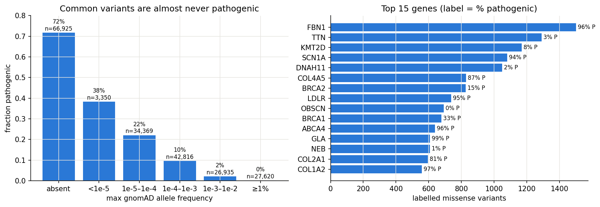
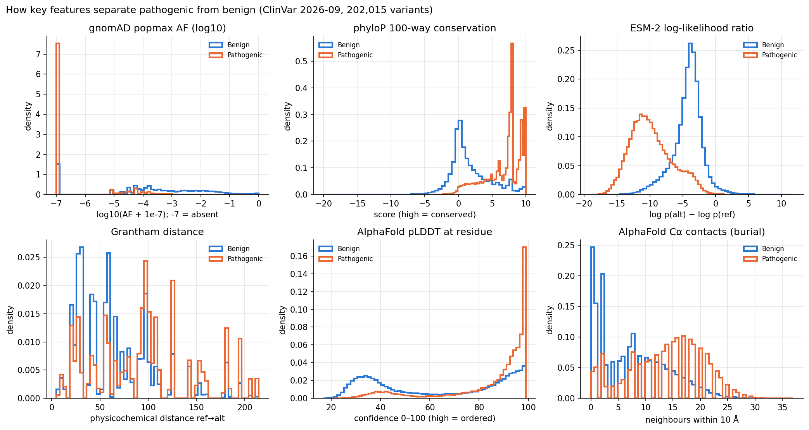
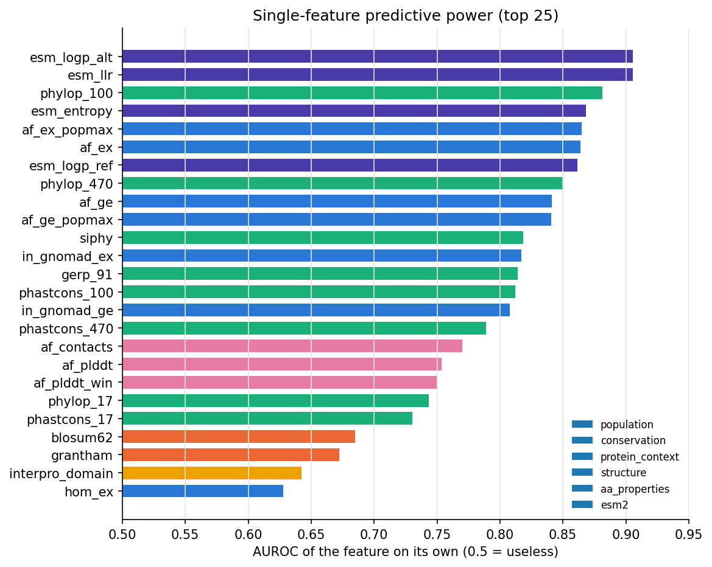

# Study Guide: Leakage-Controlled Prediction of Pathogenic Missense Variants

*A complete walkthrough of our B.Tech major project, written for someone starting from zero.*
*Every number in this guide comes from our own data and code. The script that produced the
analysis numbers is `src/09_dataset_analysis.py`; its outputs are in `results/analysis/`.*

**How to read this guide.** Go in order. Each part builds on the one before it.

| Part | Topic |
|---|---|
| 1 | The biology you need (DNA → protein → variant) |
| 2 | The problem and why it is hard |
| 3 | The datasets: what each one is, what we took from it, how we filtered it |
| 4 | Every feature: where it comes from, what it means, what it looks like |
| 5 | What the data analysis shows |
| 6 | ESM-2 in depth: what we feed in, what comes out, how it becomes features |
| 7 | How the models are trained (LR, XGBoost, calibration) |
| 8 | How we test honestly (leakage, three splits, metrics) |
| 9 | The research papers and baselines: their limitations and how we fixed them |
| 10 | Our results and how to interpret them |
| 11 | The code, script by script |
| 12 | Glossary and self-test questions |

---

# Part 1: The biology you need

## 1.1 DNA, genes and proteins as a computer program

| Biology | Analogy | Facts |
|---|---|---|
| **DNA** | Source code | About 3 billion letters, written in a 4-letter alphabet: A, C, G, T |
| **Gene** | A function in the code | About 20,000 genes make proteins |
| **Codon** | One instruction | 3 DNA letters code for 1 amino acid (e.g. `CGC` = Arginine) |
| **Protein** | The running program | A chain of amino acids. There are 20 kinds, each written with one letter (A, R, N, D, C …) |

The cell reads a gene three letters at a time and builds the protein one amino acid at a time.
The order of amino acids decides how the protein folds and what it does.

## 1.2 What is a missense variant?

A **variant** is a position where a person's DNA differs from the reference genome.
A **missense variant** changes one DNA letter in a way that changes one amino acid.

Our running example is **TP53 R175H**, the most famous cancer mutation:

```
DNA (reference):  ... CGC ...      codon 175 of TP53  -> Arginine (R)
DNA (variant):    ... CAC ...      G changed to A      -> Histidine (H)
Protein:          ...V-R-R-C-P-H... becomes ...V-R-H-C-P-H...   (position 175)
```

Variants can be written at three levels:

| Level | Notation for TP53 R175H | What it says |
|---|---|---|
| Genome | `chr17:g.7675088C>T` | Chromosome 17, position 7,675,088, C changed to T. TP53 sits on the reverse strand, so G>A in the gene reads as C>T on the chromosome |
| Transcript (coding DNA) | `NM_000546.6:c.524G>A` | Letter 524 of the gene's coding sequence changed from G to A |
| Protein | `p.Arg175His` or `p.R175H` | Amino acid 175 changed from Arginine to Histidine |

**GRCh38** is the current version of the human reference genome. Every genome position in our project uses GRCh38.

Not every DNA change is missense:
- A **synonymous** change gives the same amino acid.
- A **nonsense** change creates a stop codon (written `Ter`).

We keep only missense changes, because they are the hardest to interpret.
A stop codon usually breaks the protein. A missense change may do nothing, or it may be disastrous.

## 1.3 Pathogenic, benign and VUS

Clinical labs classify variants with the **ACMG/AMP guidelines** (Richards et al. 2015).

| Class | Meaning |
|---|---|
| **Pathogenic (P) / Likely pathogenic (LP)** | Evidence shows the variant causes disease |
| **Benign (B) / Likely benign (LB)** | Evidence shows the variant is harmless |
| **VUS** (variant of uncertain significance) | Not enough evidence either way |

> **VUS is not a third biological type.** It means "we don't know yet." So our model learns only
> P/LP (label 1) against B/LB (label 0). The model can then be used to help resolve VUS variants.

The ACMG framework has 28 evidence criteria. Computational predictions like ours count as:
- **PP3**: computational evidence that supports pathogenic.
- **BP4**: computational evidence that supports benign.

Our tool produces this PP3/BP4 evidence. It does not produce a diagnosis.

---

# Part 2: The problem and why it is hard

Sequencing a patient finds thousands of variants, and most rare missense variants end up as VUS.
A model that predicts pathogenicity gives experts extra evidence.

**The hidden trap is data leakage.** Many published tools report AUROC above 0.95, but those
numbers are often inflated. Grimm et al. 2015 described two kinds of "circularity":

1. **Type 1: the same variants in training and testing.**
   - A tool is trained on ClinVar, then tested on ClinVar.
   - Many test variants were in its training set, so it is like a student who has seen the exam answers.
2. **Type 2: whole genes with one label.**
   - In our data, **11,726 of 15,264 genes (77%) contain only benign labelled variants**, and 209 contain only pathogenic ones.
   - **35% of all variants** sit in such single-class genes.
   - A model can score well by learning "variants in gene X are benign" without understanding the variant at all.

**Our project's core idea:**
- Build a good predictor.
- Use only biological evidence as input.
- Test it in ways that rule out both kinds of circularity.
- Make its probabilities honest (calibrated).
- Make its decisions explainable.

---

# Part 3: The datasets

We use six data sources. Only one (ClinVar) provides labels. The other five provide features.

| # | Dataset | What it is | What we take | Labels or features? |
|---|---|---|---|---|
| 1 | **ClinVar** (NCBI) | Public archive where labs submit their classification of variants | P/LP vs B/LB label, gene, protein change | **Labels only** |
| 2 | **gnomAD** (via MyVariant.info) | Allele frequencies from hundreds of thousands of sequenced people | How common the variant is in the population | Features |
| 3 | **dbNSFP** (via MyVariant.info) | A database of precomputed scores for every possible protein-changing SNV in the genome | Conservation scores, InterPro domains, and baseline tool scores | Features + baselines |
| 4 | **UniProt / Swiss-Prot** | Curated database of protein sequences and functional sites | Protein sequence, domains, active and binding sites | Features (and ESM input) |
| 5 | **AlphaFold DB** | Predicted 3-D structures for nearly all human proteins | Confidence (pLDDT) and burial at the variant residue | Features |
| 6 | **ESM-2 650M** (Meta AI) | Protein language model trained on about 65 million protein sequences | How "natural" the mutant amino acid looks to the model | Features |

## 3.1 ClinVar: where the labels come from

ClinVar provides a large table called `variant_summary.txt.gz` (about 450 MB compressed).
Each row describes one variant on one genome assembly. Below is the real row for TP53 R175H
(release 2026-09), showing the columns we use:

| Column | Value | Used for |
|---|---|---|
| Type | `single nucleotide variant` | filter |
| Name | `NM_000546.6(TP53):c.524G>A (p.Arg175His)` | gene + protein change |
| ClinicalSignificance | `Pathogenic` | **label** |
| ReviewStatus | `reviewed by expert panel` | quality filter (3 stars) |
| NumberSubmitters | 39 | (info) |
| Assembly | `GRCh38` | filter |
| Chromosome / PositionVCF / Ref / Alt | `17 / 7675088 / C / T` | genome coordinates |
| LastEvaluated | `Sep 06, 2024` | (info) |

**Review stars** show how much the label can be trusted:

| ReviewStatus | Stars | P/B SNV rows in 2026-09 | Kept? |
|---|---|---|---|
| criteria provided, single submitter | ★ | 1,082,942 | Yes |
| criteria provided, multiple submitters, no conflicts | ★★ | 385,671 | Yes |
| reviewed by expert panel | ★★★ | 11,880 | Yes |
| practice guideline | ★★★★ | 19 | Yes |
| no assertion criteria provided | 0 | 48,290 | **No** |
| conflicting classifications | — | (removed by the label filter) | **No** |

**We use two releases:**
- **2023-01 (January 2023):** our "past". The time-travel model trains only on what was known then.
- **2026-09 (September 2026):** the latest. Variants that got a label after Jan 2023 become the time-travel test set.

### The filtering funnel (release 2026-09)

`src/01_build_clinvar.py` turns 9.2 million rows into 202,015 clean training examples:

| Step | Rows left | What was removed |
|---|---|---|
| All rows in file | 9,223,698 | — |
| GRCh38 assembly only | 4,578,190 | Duplicate rows for the older GRCh37 genome |
| Single-nucleotide variants | 4,238,174 | Deletions, insertions, copy-number changes |
| Label is P/LP or B/LB | 1,528,802 | VUS, conflicting, drug response, risk factor, … |
| ≥ 1 review star | 1,480,512 | Labels with no stated criteria |
| Protein change is missense | 202,255 | Synonymous, nonsense (stop), splice, non-coding |
| Final (deduplicated, valid A/C/G/T alleles) | **202,015** | Duplicates; same variant with contradicting labels |

The same steps on release 2023-01 give **91,261** variants. Merged, the two releases give
**215,400 unique variants**.

**How "missense" is detected.** We parse the HGVS protein change at the end of the Name column with a
regular expression: `(p.Arg175His)` gives ref = R, position = 175, alt = H.
- The change is kept only when ref ≠ alt and alt is not `Ter` (stop).
- Three-letter codes are converted to one-letter codes (Arg → R, His → H).

**Each variant gets two IDs:**
- `key = 17-7675088-C-T`, used internally.
- `hgvs = chr17:g.7675088C>T`, used to query MyVariant.info.

## 3.2 gnomAD: how common is the variant?

gnomAD (Genome Aggregation Database) lists, for every variant seen in hundreds of thousands of sequenced people,
its **allele frequency (AF)**: the fraction of all chromosomes that carry it.
- An AF of 0.01 means 1% of chromosomes carry the variant.
- If the variant is not in gnomAD at all, nobody in that large sample carried it, which is a hint that it may be harmful.

**Why it matters:** a disease-causing variant cannot be common, because natural selection removes it.
ACMG rule **BA1** says that AF above 5% means benign.

We get gnomAD through **MyVariant.info**, a free web API.
- We send it a batch of up to 1,000 HGVS IDs.
- It returns gnomAD and dbNSFP fields as JSON.
- 215,400 variants took about 216 requests.

## 3.3 dbNSFP: conservation scores and baselines

**dbNSFP** precomputes about 40 scores for all of the roughly 84 million possible protein-changing SNVs. We take two kinds:
- **Conservation scores** (features): has this DNA position stayed the same across evolution? Explained in Part 4.
- **Published predictor scores** (baselines only): AlphaMissense, REVEL, CADD, ESM1b, PrimateAI, ClinPred, MetaRNN, VARITY.
  - These are stored with a `bl_` prefix and **never** given to the model.
  - We only compare against them.

## 3.4 UniProt: the protein

UniProt **Swiss-Prot** is the expert-curated protein database. We download two files:
1. **FASTA sequences** for all 20,431 reviewed human proteins. This is the input for ESM-2.
2. **A feature table**: where each protein has domains, active sites, binding sites, disulfide bonds, transmembrane segments, and so on.

**Mapping a variant to a protein:**
1. Take the gene name from ClinVar (TP53).
2. Find its canonical UniProt protein (P04637).
3. **Check that the amino acid at the stated position matches.** `sequence[175-1]` must be `R`.

This works for **93%** of variants. The other 7% are numbered on a different isoform (alternative
version) of the protein. They still enter the model, but their protein, structure and ESM-2 features
are left empty (NaN).

## 3.5 AlphaFold DB: the 3-D structure

AlphaFold (DeepMind) predicted the 3-D structure of almost every human protein. For each protein we
download one PDB file (`AF-P04637-F1-model_v6.pdb`) and read the Cα atom (the backbone atom) of every residue:
- its **x, y, z coordinates**;
- its **pLDDT** (stored in the B-factor column): AlphaFold's confidence from 0 to 100.
  - Above 90: well folded and ordered.
  - Below 50: usually a disordered, floppy region.

Coverage is 81%. Very long proteins (over 2,700 amino acids, such as BRCA2 and TTN) have no single-file model.

## 3.6 ESM-2: the protein language model

ESM-2 is covered in Part 6. In short, it is a transformer (like GPT, but for proteins) that read
millions of natural protein sequences. It can tell how "normal" an amino acid looks at each position.

---

# Part 4: Every feature, explained

The model gets **90 biological features**; Model D adds **20 ESM-2 features** for **110** in total.
Below, every feature is shown with:
- its source;
- what it means;
- its typical value in pathogenic (P) and benign (B) variants (median);
- its **single-feature AUROC**: how well it separates P from B *on its own*.

An AUROC of 0.5 means useless and 1.0 means perfect; we report it in whichever direction works.
Full table: `results/analysis/feature_stats.csv`.

**Two worked examples** recur below:
- **TP53 R175H**: pathogenic, cancer.
- **BRCA1 P871L**: benign, and very common (40% of chromosomes carry it).

## 4.1 Population frequency (8 features, from gnomAD)

| Feature | Meaning | Encoding | Median P | Median B | AUROC |
|---|---|---|---|---|---|
| `af_ex` | Allele frequency in gnomAD exomes | log10(AF + 1e-7); −7 means absent | −7.0 | −4.41 | 0.864 |
| `af_ge` | Allele frequency in gnomAD genomes | same | −7.0 | −4.48 | 0.841 |
| `af_ex_popmax` | Highest AF in any ancestry group (African, East Asian, European, …), exomes | same | −7.0 | −3.69 | **0.865** |
| `af_ge_popmax` | Same for genomes | same | −7.0 | −3.68 | 0.841 |
| `hom_ex`, `hom_ge` | Number of people carrying **two** copies | log10(count + 1) | 0 | 0 | 0.63 |
| `in_gnomad_ex`, `in_gnomad_ge` | Is the variant in gnomAD at all? | 0/1 | 0 | 1 | 0.82 |

**Why the log transform?** AF ranges from 0.000001 to 0.9. On a log scale, 1-in-a-million and
1-in-100 are evenly spaced, which helps the model. We add 1e-7 so that AF = 0 becomes −7 instead of minus infinity.

**Why popmax?** A variant can be rare overall but common in one population (say, 3% in East Asians).
If it were disease-causing, it could not be that common anywhere. Popmax captures this.

| Example | `af_ex` | Real AF | Homozygotes |
|---|---|---|---|
| TP53 R175H | −5.39 | about 4 in a million | 0 |
| BRCA1 P871L | −0.39 | **40%** | about 22,900 people carry two copies |

That benign example is extremely common, so it simply cannot cause a rare disease.

## 4.2 Conservation (9 features, from dbNSFP)

**Idea:** if a DNA position is identical in humans, mice, birds and fish, evolution has protected
it for hundreds of millions of years, so changing it is probably harmful. Conservation scores
measure this from alignments of many species' genomes.

| Feature | Meaning | Median P | Median B | AUROC |
|---|---|---|---|---|
| `phylop_17` | phyloP using 17 primates (positive = conserved) | 0.66 | 0.32 | 0.743 |
| `phylop_100` | phyloP using 100 vertebrates | **7.63** | 0.85 | **0.881** |
| `phylop_470` | phyloP using 470 mammals | 7.85 | 1.32 | 0.850 |
| `phastcons_17/100/470` | Probability (0–1) that the position is in a conserved element | 1.0 | 0.50 (100-way) | 0.73–0.81 |
| `gerp_91` | GERP++ "rejected substitutions" across 91 mammals | 3.90 | 0.55 | 0.814 |
| `siphy` | SiPhy log-odds of conservation (29 mammals) | 15.7 | 8.7 | 0.818 |
| `bstatistic` | Background selection strength (lower = more selection nearby) | 691 | 765 | 0.557 |

**phyloP 100-way is the single best biological feature.** Pathogenic variants pile up at about 8
(highly conserved), while benign ones peak near 0.

Missing values: `gerp_91` is missing for 23.5% of variants and `phylop_470` for 8.6%. XGBoost
handles this natively (see Part 7).

## 4.3 Protein context (17 features, from UniProt + dbNSFP)

| Feature | Meaning | AUROC | Note |
|---|---|---|---|
| `rel_pos` | Position ÷ protein length (0 = start, 1 = end) | 0.509 | Almost useless alone |
| `log_prot_len` | log10(protein length) | 0.586 | Longer proteins tend to have more benign variants (gene effect, see Part 5) |
| `interpro_domain` | Inside a known InterPro domain (from dbNSFP)? | 0.642 | 59% of P vs 30% of B are inside a domain |
| `dist_func_site` | Distance (in residues, capped at 50) to the nearest UniProt active or binding site | 0.608 | Closer means more pathogenic |
| `uni_domain` | Inside a UniProt domain | 0.559 | |
| `uni_active_site` | Exactly at a catalytic residue | 0.501 | Rare (0.3% of P), but very informative when present |
| `uni_binding_site` | Exactly at a ligand-binding residue | 0.515 | |
| `uni_disulfide` | Cysteine in a disulfide bond | 0.521 | 4.2% of P vs 0.0% of B |
| `uni_transmem` | Inside a membrane-spanning segment | 0.525 | |
| `uni_signal` | Inside a signal peptide | 0.50 | |
| `uni_mod_res` | Modified residue (phosphorylation etc.) | 0.50 | |
| `uni_zn_finger`, `uni_motif` | Zinc finger, short motif | 0.50 | |
| `uni_helix`, `uni_strand` | Secondary structure (α-helix, β-strand) | 0.60 / 0.55 | Structured regions are more often P |
| `uni_region` | Annotated "region", often disordered | 0.552 | More often B |
| `uni_compbias` | Low-complexity sequence | 0.528 | More often B |

How each flag is computed: UniProt writes features as text, for example `DOMAIN 94..292` or
`BINDING 176`. We parse the start and end of each one and check whether the variant position falls inside.

Disulfide bonds are listed as pairs (`DISULFID 22..58` means residues 22 and 58 are bonded, not the whole range), so only those two endpoints count.

**TP53 R175H** has `interpro_domain` = 1 (p53 DNA-binding domain), `uni_helix` = 1, and `dist_func_site` = 1 (one residue from a zinc-binding site).

## 4.4 Structure (3 features, from AlphaFold)

| Feature | Meaning | Median P | Median B | AUROC |
|---|---|---|---|---|
| `af_plddt` | AlphaFold confidence at this residue (0–100) | **93** | 64 | 0.754 |
| `af_plddt_win` | Mean pLDDT over ±5 neighbouring residues | 92 | 66 | 0.750 |
| `af_contacts` | Number of other Cα atoms within 10 Å (skipping the 2 immediate neighbours), a measure of **burial** | **15** | 6 | 0.770 |

**Intuition:**
- A residue buried in the core of a well-folded protein is surrounded by neighbours. Changing it can break the fold.
- A residue on a floppy, exposed loop (low pLDDT, few contacts) usually tolerates change.

| Example | pLDDT | Contacts | Reading |
|---|---|---|---|
| TP53 R175H | 96.6 | 21 | Buried in an ordered domain |
| BRCA1 P871L | 34.6 | 4 | In a disordered region |

## 4.5 Amino-acid properties (53 features, computed)

These describe how different the new amino acid is from the old one.

| Feature | Meaning | Median P | Median B | AUROC |
|---|---|---|---|---|
| `grantham` | Grantham distance (1974): combines composition, polarity and volume; 5 (similar) to 215 (very different) | 98 | 58 | 0.673 |
| `blosum62` | How often this swap happens in evolution (negative = rare, bad) | −1 | 0 | 0.685 |
| `d_hydropathy` | Change in Kyte-Doolittle hydrophobicity | 0 | 0.3 | 0.555 |
| `d_volume` | Change in side-chain volume (ų) | 13 | 2 | 0.522 |
| `d_polarity`, `d_charge` | Change in polarity, change in charge (D, E = −1; K, R = +1; H = +0.1) | — | — | 0.52–0.55 |
| `arom_change` | Gained or lost an aromatic ring (F, W, Y, H) | — | — | 0.542 |
| `ref_is_P/G/C`, `alt_is_P/G/C` | Old or new amino acid is Proline, Glycine or Cysteine (special structural roles) | — | — | 0.51–0.55 |
| `ref_A … ref_Y`, `alt_A … alt_Y` | One-hot: which amino acid was there (20) and which it became (20) | — | — | — |

**The Grantham formula** (computed in `src/05_build_dataset.py`):

```
D = 50.723 × sqrt( 1.833·(c₁−c₂)² + 0.1018·(p₁−p₂)² + 0.000399·(v₁−v₂)² )
    c = composition, p = polarity, v = volume (Grantham's table)
```

> **Important lesson:** these features are weak alone (AUROC about 0.67).
> TP53 R175H has a *small* Grantham distance (29, since Arg and His are similar), yet it is lethal for
> the protein. BRCA1 P871L has a *large* one (98) but is harmless.
> **Where** a change happens matters more than **what** the change is, which is why conservation, structure and ESM-2 matter.

## 4.6 ESM-2 (4 features + 16 embedding components)

| Feature | Meaning | Median P | Median B | AUROC |
|---|---|---|---|---|
| `esm_llr` | log p(alt) − log p(ref): how much less likely the mutant is than the original | **−10.2** | −4.0 | **0.906** |
| `esm_logp_ref` | log-probability of the original amino acid (near 0 = the model is sure it belongs there) | −0.003 | −0.27 | 0.862 |
| `esm_logp_alt` | log-probability of the new amino acid | −10.3 | −4.3 | 0.906 |
| `esm_entropy` | Uncertainty at the position: low = only one amino acid fits; high = many fit | 0.02 | 1.04 | 0.868 |
| `esm_pc1 … esm_pc16` | 16 principal components of the 1,280-number "embedding" describing the residue in context | — | — | — |

**`esm_llr` is the strongest single feature in the whole project (0.906).** Part 6 explains exactly how it is computed.

## 4.7 Features we deliberately do NOT use

| Not used | Why |
|---|---|
| ClinVar classification, star rating, submitter count | That is the answer itself (label leakage) |
| AlphaMissense, REVEL, CADD, ESM1b, PrimateAI scores | Other people's models; using them would hide their leakage inside ours. Kept as baselines only |
| ClinPred, MetaRNN, VARITY scores | Trained on ClinVar, so directly circular |
| Gene name / gene ID | Would let the model memorise "gene X = benign" (type-2 circularity) |

---

# Part 5: What the data analysis shows

Figures are in `results/figures/eda_*.png`.

## 5.1 Class balance

| | Total | Pathogenic | Benign | % Pathogenic |
|---|---|---|---|---|
| ClinVar 2023-01 | 91,261 | 35,243 | 56,018 | 38.6% |
| ClinVar 2026-09 | 202,015 | 61,611 | 140,404 | 30.5% |
| Time-travel test (new since 2023) | 124,139 | 30,333 | 93,806 | 24.4% |

There are more benign than pathogenic variants, so we report AUPRC alongside AUROC.

The pathogenic share **falls over time**: 38.6% in 2023, but only 24.4% among variants labelled
later. Large labs have recently submitted many benign variants. This "label shift" matters for calibration (Part 10).

## 5.2 Allele frequency is a powerful but partly "circular" signal



| Max gnomAD AF | Variants | % pathogenic |
|---|---|---|
| Absent | 66,925 | **72%** |
| < 1e-5 | 3,350 | 38% |
| 1e-5 to 1e-4 | 34,369 | 22% |
| 1e-4 to 1e-3 | 42,816 | 10% |
| 1e-3 to 1e-2 | 26,935 | 2% |
| ≥ 1% | 27,620 | **0.2%** |

Common variants are almost never pathogenic.

But there is a catch: **ClinVar curators themselves use AF to label variants benign** (rules BA1 and BS1).
So part of AF's predictive power is the model rediscovering the curators' rule.

That is why we also report results on **rare variants only** (AF < 1e-4), where this shortcut is unavailable.

## 5.3 Genes: the type-2 circularity problem in our data

| Statistic | Value |
|---|---|
| Genes with ≥ 1 labelled variant | 15,264 |
| Median variants per gene | 5 |
| Genes with only one variant | 2,585 |
| Share of variants in the 100 biggest genes | 20.2% |
| Genes where **every** variant is benign | **11,726 (77%)** |
| Genes where every variant is pathogenic | 209 |
| Variants that sit in such single-class genes | **35.3%** |

Look at the top genes:
- **FBN1** (Marfan syndrome): 96% pathogenic.
- **TTN** (a giant muscle protein): 3% pathogenic.

A model that recognised the gene could score highly without understanding variants. We therefore:
1. never give the gene name as a feature;
2. test on held-out genes (gene-disjoint split);
3. watch for features that act as gene proxies. Protein length turned out to be one (Part 10).

## 5.4 Amino acids

| Original amino acid | % pathogenic when changed |
|---|---|
| Cys (C) | 77% |
| Trp (W) | 74% |
| Gly (G) | 53% |
| … | |
| Ala (A) | 18% |
| Val (V) | 15% |

| Most common change | Count | % pathogenic |
|---|---|---|
| R→Q | 8,889 | 15% |
| A→T | 7,147 | 11% |
| R→H | 6,665 | 18% |
| V→I (very similar amino acids) | 5,921 | **2.4%** |
| G→R | 5,468 | **56.5%** |

Cysteines form disulfide bonds and glycines give backbone flexibility, so mutating them is often harmful.
Similar swaps like V→I are almost always tolerated.

## 5.5 How the features separate the classes



Each panel shows the distribution of one feature for benign (blue) and pathogenic (orange) variants.

| Feature | Separation |
|---|---|
| **ESM-2 LLR** | Clearest. Benign peak near −4, pathogenic near −11 |
| **phyloP** | Pathogenic variants pile up at the maximum conservation score |
| **AlphaFold pLDDT and contacts** | Pathogenic variants sit in ordered, buried residues |
| **Grantham** | Distributions overlap heavily (weak) |



## 5.6 Missing values

| Feature group | Average missing |
|---|---|
| Population, amino-acid properties | 0% |
| Conservation | 3.9% (GERP 23.5%) |
| Protein context | 6.1% |
| ESM-2 | 7.0% |
| Structure | 18.9% |

Missingness comes from three causes:
- isoform mismatch (7%);
- long proteins with no AlphaFold model;
- gaps in genome alignments.

## 5.7 Label stability

Only **15** variants flipped between pathogenic and benign from 2023 to 2026. Confident ClinVar labels are stable.

---

# Part 6: ESM-2 in depth

## 6.1 What is a protein language model?

A language model like GPT learns English by predicting missing or next words. **ESM-2** does the
same for proteins:
- It read about 65 million natural protein sequences (UniRef50).
- During training, 15% of the amino acids in each sequence were hidden.
- The model had to guess them from the rest of the sequence.

To guess well, it had to learn which amino acids fit where: conservation, structure and chemistry.
It learned this without ever seeing a label like "pathogenic".

So if the model is very sure that position 175 of TP53 must be R, and the mutant puts H there, the
mutant is "unnatural" and probably harmful.

| ESM-2 size | Layers | Parameters | Embedding size |
|---|---|---|---|
| esm2_t6_8M | 6 | 8 million | 320 |
| esm2_t12_35M | 12 | 35 million | 480 |
| **esm2_t33_650M (we use this)** | 33 | 650 million | **1,280** |
| esm2_t36_3B / t48_15B | 36 / 48 | 3B / 15B | 2,560 / 5,120 |

We use 650M: it fits in our 6 GB GPU at half precision (fp16), and it is the size most papers use.

## 6.2 What we feed into ESM-2 (the input)

**ESM-2 never sees DNA.** Its input is the **protein sequence**: a string of one-letter amino-acid codes.

For TP53 that is the canonical UniProt sequence P04637, which is 393 amino acids long:

```
MEEPQSDPSVEPPLSQETFSDLWKLLPENNVLSPLPSQAMDDLMLSPDDIEQWFTEDPGP ...   (393 letters)
                       around position 175:   QSQHMTEVVRRCPHHERCSDSD
                                                         ^ R at 175
```

**Step 1: tokenisation.** The tokenizer turns each letter into an integer ID and adds two special tokens: `<cls>` at the start and `<eos>` at the end.

```
tokens:    <cls>  M   E   E   P   Q   S   D   P   S   V   E  ...  <eos>
token IDs:   0   20   9   9  14  16   8  13  14   8   7   9  ...    2
```

A 393-residue protein becomes **395 tokens**, so residue *i* sits at token index *i*: index 0 is `<cls>`.

The vocabulary has 33 tokens: the 20 standard amino acids, rare or ambiguous letters (X, B, U, Z, O), and special tokens.

**Important design choice: we feed the original (wild-type) sequence once.** We do not feed the mutant
sequence, and we do not mask the position. This is called **wild-type marginal** scoring (Meier 2021; Brandes 2023).
- One forward pass gives predictions for all 20 amino acids at every position at once.
- So one pass per protein scores every possible variant in it.
- That is why scoring 200,254 variants took only about 40 minutes.

## 6.3 What comes out of ESM-2 (the output)

For TP53 (395 tokens), one forward pass returns two things:

| Output | Shape | Meaning |
|---|---|---|
| `logits` | 1 × 395 × 33 | At every position, a score for each of the 33 tokens |
| `hidden_states[-1]` (last layer) | 1 × 395 × 1,280 | At every position, a vector of 1,280 numbers describing that residue in context: the **embedding** |

**Step 2: logits to probabilities.**
1. Take the logits at token 175.
2. Keep only the 20 amino-acid columns.
3. Apply log-softmax.

Real output for TP53 position 175:

| Amino acid | Probability |
|---|---|
| **R (Arg, the original)** | **0.9992** |
| K (Lys) | 0.0003 |
| C (Cys) | 0.0001 |
| H (His, our mutant) | 0.000108 |
| Q (Gln) | 0.0001 |

The model is 99.9% sure that arginine belongs here.

**Step 3: the four ESM scalar features.**

```
esm_logp_ref = log p(R)          = -0.001
esm_logp_alt = log p(H)          = -9.130
esm_llr      = log p(H) - log p(R) = -9.129     ← strongly negative = damaging
esm_entropy  = -Σ p·log p over 20 AAs = 0.0086   ← near 0 = only one amino acid fits
```

Compare the most tolerant position in TP53, residue 53 (W): its entropy is 2.63, close to the
maximum of ln 20 ≈ 3.0. Almost any amino acid fits there.

| Example | LLR | Entropy | Reading |
|---|---|---|---|
| BRCA1 P871L (benign) | −2.77 | 1.88 | Change tolerated |
| TP53 R175H (pathogenic) | −9.13 | 0.009 | Change not tolerated |

A rough rule from Brandes 2023: LLR below about −7.5 suggests pathogenic.

**Step 4: the embedding to 16 PCA features.**
- The 1,280-number embedding at position 175 starts `[0.227, 0.078, 0.098, −0.093, −0.444, …]`.
- 1,280 numbers per variant is too many for the trees, and they would invite overfitting.
- We compress them with **PCA** (principal component analysis) to the 16 directions of greatest variation: `esm_pc1 … esm_pc16`.
- **The PCA is fit on training variants only.** Fitting it on test data would leak information.

## 6.4 Long proteins: sliding windows

ESM-2 can read at most 1,022 amino acids at once (1,024 tokens with `<cls>` and `<eos>`). For longer proteins:
- we cut **windows of 1,022 residues that overlap by 511**;
- for each variant, we use the window where the variant sits **most centrally**, so the model sees enough context on both sides.

Example: a 2,000-residue protein gets windows [0–1022), [511–1533) and [978–2000). Residue 1,200 uses the middle window.

## 6.5 The code path (src/04_esm2_features.py)

```python
tok   = AutoTokenizer.from_pretrained("facebook/esm2_t33_650M_UR50D")
model = EsmForMaskedLM.from_pretrained(..., torch_dtype=torch.float16).cuda()
enc   = tok(protein_sequence, return_tensors="pt")             # input: amino-acid string
out   = model(**enc, output_hidden_states=True)                # one forward pass
lp    = log_softmax(out.logits[0], -1)[:, ids_of_20_amino_acids]  # (L+2, 20)
llr   = lp[pos, alt] - lp[pos, ref]                            # pos = residue number (token index)
emb   = out.hidden_states[-1][0, pos]                          # 1280-d vector
```

## 6.6 Why combine ESM-2 with other features?

| How ESM-2 is used | AUROC (time-travel test) |
|---|---|
| ESM-2 LLR alone, zero-shot | 0.916 |
| ESM-2 features alone, in XGBoost | 0.946 |
| All features together (Model D) | **0.987** |

ESM-2 only knows protein sequences. It does not know:
- how common the variant is in people (gnomAD);
- DNA-level conservation across species;
- 3-D burial;
- curated functional sites.

The other feature groups add exactly that information.

---

# Part 7: How the models are trained

## 7.1 The three models (from the proposal deck)

| Model | Algorithm | Features | Role |
|---|---|---|---|
| **B** | Logistic regression | 90 biological | Simple, interpretable baseline |
| **C** | XGBoost | 90 biological | Stronger non-linear model |
| **D** | XGBoost | 90 biological + 20 ESM-2 = 110 | Final model |

**Logistic regression (B)** computes a weighted sum of features and squashes it into a probability:

```
P(pathogenic) = 1 / (1 + e^-(w₀ + w₁x₁ + … + w₉₀x₉₀))
```

It needs complete inputs, so missing values are filled with the median (plus a 0/1 "was missing" flag),
and every feature is standardised (mean 0, standard deviation 1).

**XGBoost (C, D)** is gradient-boosted decision trees:
- Tree 1 makes a rough prediction.
- Tree 2 is trained to fix tree 1's errors, tree 3 fixes the remaining errors, and so on.
- We use **700 trees**.

Each tree asks yes/no questions, for example: "Is phyloP > 4.2? Is the variant absent from gnomAD? Is ESM LLR < −7?"

It is well suited to our data because:
1. It captures interactions. For example, a low ESM LLR matters more when the residue is buried.
2. It handles missing values natively. Each split learns which way to send variants with a missing value.
3. It works with **TreeSHAP**, which explains every prediction exactly.

**Hyper-parameters** (in `src/common.py`):

| Parameter | Value | Meaning |
|---|---|---|
| `n_estimators` | 700 | Number of trees |
| `learning_rate` | 0.04 | How much each tree corrects the previous ones (small = careful) |
| `max_depth` | 6 | Maximum questions per tree path |
| `subsample` | 0.8 | Each tree sees a random 80% of rows |
| `colsample_bytree` | 0.7 | Each tree sees a random 70% of features (reduces overfitting) |
| `min_child_weight` | 5 | Leaves need enough data |
| `reg_lambda` | 2.0 | L2 regularisation |

Training runs on the GPU (`device="cuda"`, `tree_method="hist"`).

## 7.2 Calibration: making probabilities honest

A raw classifier score is not automatically a true probability. "0.8" should mean that 80% of such variants
are really pathogenic. **Isotonic regression** learns a monotone step function that maps raw scores to
observed frequencies.

**Training procedure for every model** (`VariantModel.fit` in `src/common.py`):

```
training data
 ├── 85% "fit" part   ── (D only) fit PCA on ESM embeddings ── train LR / XGBoost
 └── 15% "calibration" part (whole genes held out!) ── fit isotonic regression
        on (raw model score -> true label)
prediction = isotonic( model(features) )
```

The calibration slice is chosen **by gene** (GroupShuffleSplit). The calibrator therefore learns how the
model behaves on genes it has not seen, which is the realistic case.

We do not reweight classes. Reweighting would distort the probabilities.

## 7.3 The four saved models (`results/models/`)

| File | Trained on | Used for |
|---|---|---|
| `B_LR_temporal.joblib`, `C_XGB_temporal.joblib`, `D_XGB_ESM_temporal.joblib` | ClinVar 2023-01 (91,261) | All time-travel results |
| `D_XGB_ESM_final.joblib` | ClinVar 2026-09 (202,015) | Real use and the demo (`src/predict.py`) |

---

# Part 8: How we test honestly

## 8.1 Three levels of testing

| Level | How it works | What it guards against |
|---|---|---|
| **1. Random 80/20** | Shuffle all 2026 variants; train on 80%, test on 20% | Nothing. Neighbouring variants of the same gene appear on both sides (an optimistic reference) |
| **2. Gene-disjoint (5-fold GroupKFold)** | Split genes into 5 groups; train on 4, test on the 5th, rotate; every gene is tested once, by a model that never saw it | Type-2 circularity (memorising genes) |
| **3. Time-travel (primary)** | Train only on labels in ClinVar 2023-01; test on the 124,139 variants that first got a label afterwards | Type-1 circularity, and it simulates real use: predicting before experts decide |

**Subsets of the time-travel test:**

| Subset | Variants | Pathogenic | Purpose |
|---|---|---|---|
| Rare (AF < 1e-4) | 71,570 | 28,545 | Removes the allele-frequency shortcut |
| New genes | 26,268 | 405 | Genes with no labelled variant in 2023: both time and gene unseen |
| Common subset | 102,384 | 25,858 | Every tool has a score, for a fair head-to-head |

## 8.2 Leakage rules enforced in code

1. ClinVar is used only to make `label_old` and `label_new`, never as a feature.
2. Published tool scores (`bl_*`) are never features.
3. Time-travel training uses the 2023 label, even if the label later changed.
4. PCA, the imputer, the scaler and the isotonic calibrator are fit only on training rows.
5. Gene-disjoint folds use gene symbols as groups.

## 8.3 Metrics explained

| Metric | Plain-English meaning | Good value |
|---|---|---|
| **AUROC** | Pick one random pathogenic and one random benign variant. AUROC is the probability that the model scores the pathogenic one higher | 1.0 perfect, 0.5 coin flip |
| **AUPRC** | Area under the precision-recall curve. Focuses on the pathogenic class, so it is more informative when one class is rare | Close to 1; baseline = % pathogenic |
| **Brier score** | Mean of (probability − true label)² | 0 is perfect; lower is better |
| **ECE** | Expected calibration error. Group predictions into 15 bins and compare the average prediction with the actual % pathogenic in each bin | 0 is perfect |
| **95% CI** | Bootstrap confidence interval. Resample the test set with replacement 1,000 times and recompute; the middle 95% of results is the interval | Narrow intervals mean a reliable estimate |
| **Likelihood ratio (LR)** | P(score in range ∣ pathogenic) ÷ P(score in range ∣ benign), used for PP3/BP4 | Higher = stronger evidence |

## 8.4 Ablation and SHAP

- **Ablation:** retrain Model D without one feature group, or with only one group, to see how much each group matters.
- **SHAP (Shapley values):** for one prediction, how much did each feature push the score up or down?
  - It comes from game theory: each feature is a "player" and the prediction is the "payout".
  - TreeSHAP computes it exactly for tree models.

---

# Part 9: The research papers and baselines

## 9.1 The papers, their limitations, and our fixes

| Paper | What it did | Limitation | How our project addresses it |
|---|---|---|---|
| **Richards et al. 2015** (ACMG/AMP guidelines) | Defined the 28-criterion framework; computational evidence = PP3/BP4 | Gave no rule for *which* tool to use or *what score* counts as evidence; computational evidence capped at "supporting" | We output a PP3/BP4 level with thresholds that are *calibrated and validated* (following Pejaver 2022) |
| **Grimm et al. 2015** (circularity) | Showed that benchmarks overstate tool performance through type-1 and type-2 circularity | Diagnosed the problem but did not provide a predictor built to avoid it | Our time-travel and gene-disjoint tests are designed against both types. We **replicate** their finding: ClinVar-trained tools lose accuracy on new variants while honest tools gain |
| **Pejaver et al. 2022** (ClinGen calibration) | Converted tool scores into evidence strength with local posterior probability (prior 0.0441) | Calibrated only existing tools (they built no new predictor); used small data sets (11,834 calibration and 9,114 validation variants) that kept only genes with at least one pathogenic variant; one global prior (4.41%) for every gene | We **replicate** their method for REVEL, apply it to our own model, and validate the thresholds on 124,139 future variants across all genes |
| **Bergquist et al. 2025** | Extended calibration to AlphaMissense, ESM1b, VARITY and others | Same snapshot-based approach | Same fix as above |
| **Livesey & Marsh 2023** | Benchmarked 55 tools on deep mutational scanning (lab experiments), which avoids circularity | DMS exists for only a few dozen proteins, and measures function, not disease | Our time-travel test gives a circularity-free benchmark across about 15,000 genes. DMS validation is planned future work |
| **Meier et al. 2021** (ESM-1v) | Showed protein language models predict mutation effects zero-shot | Unsupervised: ignores population data, conservation and structure | We use PLM scores as *features* together with biology. ESM-2 features in XGBoost reach 0.946 vs 0.916 zero-shot |
| **Lin et al. 2023** (ESM-2) | Released the ESM-2 family (8M–15B parameters) | General protein model, not tuned for disease | We extract LLR, entropy and embeddings from it and learn disease relevance with XGBoost |
| **Lundberg et al. 2020** (TreeSHAP) | Exact, fast Shapley values for tree ensembles | — | Used for all our explanations |

## 9.2 The baseline tools

| Tool | How it works | Trained on | Limitation | Our AUROC (time-travel) |
|---|---|---|---|---|
| **REVEL** (Ioannidis 2016) | Random forest that combines 13 other tools' scores (SIFT, PolyPhen, MutationTaster, GERP, phyloP …) | HGMD disease mutations vs. rare ESP variants | A "score of scores": hard to interpret biologically; inherits any circularity in its component tools; output is a score, not a calibrated probability | 0.975 |
| **CADD** (Rentzsch 2019) | Logistic model over 60+ annotations, genome-wide (all variant types) | Proxy labels: simulated new variants vs. variants fixed in humans since the chimp split | Proxy labels are not clinical, so it is weaker for missense; PHRED rank score, not a probability | 0.939 |
| **AlphaMissense** (Cheng 2023) | AlphaFold-derived network fine-tuned on weak labels | Population frequency: variants common in humans or primates count as benign; **no ClinVar** | Black box with no per-feature explanation; precomputed only; non-commercial licence | 0.966 |
| **ESM1b** (Brandes 2023) | Zero-shot protein language model LLR (650M parameters, older model) | No labels | Ignores population and DNA conservation data; no probabilities, only a threshold | 0.940 |
| **PrimateAI** (Sundaram 2018) | Deep CNN on sequence and structure | Common primate variants as benign | Weaker on clinical labels | 0.890 |
| **ClinPred\*** | Gradient boosting + random forest | **ClinVar** | Circular: tested on its own training labels, its accuracy is inflated | 0.980 |
| **MetaRNN\*** | Recurrent neural network over many scores | **ClinVar** | Circular | 0.985 |
| **VARITY\*** | Gradient boosting | ClinVar, HGMD and others | Partly circular | 0.974 |

\* We report these but never treat them as fair competitors.

**How our approach differs from all of them:**
1. **Inputs:** only raw biological evidence. No other tool's score enters the model.
2. **Validation:** a strict time-travel test plus a gene-disjoint test.
3. **Output:** a calibrated probability, plus a PP3/BP4 level validated on future data.
4. **Explanation:** a per-variant SHAP explanation in terms of biology ("absent from gnomAD, buried, highly conserved").
5. **Openness:** fully open and reproducible on a laptop with public data.

---

# Part 10: Results and how to interpret them

## 10.1 Main result (time-travel test, 124,139 variants)

| Method | AUROC | AUPRC |
|---|---|---|
| **D: XGBoost + ESM-2 (ours)** | **0.987** | **0.967** |
| C: XGBoost (ours) | 0.984 | 0.960 |
| REVEL | 0.975 | 0.936 |
| B: Logistic regression (ours) | 0.974 | 0.929 |
| AlphaMissense | 0.966 | 0.904 |
| ESM1b | 0.940 | 0.855 |
| CADD | 0.939 | 0.799 |
| ESM-2 zero-shot (ours) | 0.916 | 0.841 |

**How to say it:** "Our model beats every published tool that was not trained on ClinVar.
The 95% confidence intervals do not overlap: 0.986–0.987 for us against 0.974–0.976 for REVEL."

## 10.2 Across the three levels of testing (Model D)

| Test | AUROC |
|---|---|
| Random | 0.992 |
| Gene-disjoint | 0.988 |
| Time-travel | 0.987 |

The small drop means our features describe the variant itself, not which gene it is in.

## 10.3 Where we are strong and weak

- **Rare variants:** 0.983. We keep the lead without the allele-frequency shortcut.
- **New genes:** 0.973 AUROC, against 0.986 for AlphaMissense.
  - This is our weak spot, though we have the best AUPRC there (0.813).
  - Only 405 pathogenic variants are in this subset, so the comparison is noisy.

## 10.4 Ablation (which evidence matters)

| Feature group | AUROC change if removed | AUROC alone |
|---|---|---|
| Conservation | −0.008 | 0.926 |
| Population | −0.007 | 0.860 (0.756 on rare variants) |
| ESM-2 | −0.003 | **0.946** |
| Protein context | −0.002 | 0.854 |
| AA properties | −0.001 | 0.768 |
| Structure | −0.000 | 0.778 |

Conservation and population frequency carry information that no other group replaces.
ESM-2 is the strongest group alone. Structure overlaps with ESM-2, since both "know" about folding.

## 10.5 SHAP: what drives predictions

The top features are:
1. gnomAD popmax AF
2. gnomAD exome AF
3. ESM-2 LLR
4. protein length
5. ESM-2 log p(alt)
6. gnomAD genome AF
7. phyloP-100
8. AlphaFold contacts

**Protein length** acts partly as a gene proxy (long proteins such as TTN have mostly benign variants), which is a mild type-2 bias that we disclose.

## 10.6 Replications

| Paper | Our result |
|---|---|
| **Brandes 2023** | ESM-2 LLR gives AUROC 0.906 on ClinVar 2026 (ESM1b: 0.933). Reproduced |
| **Grimm 2015** | ClinPred and MetaRNN lose 0.005–0.006 AUROC on new variants; all honest tools gain 0.017–0.041. Circularity demonstrated |
| **Pejaver 2022** | Our REVEL thresholds have the same structure but are stricter. Partial |

## 10.7 Calibration and PP3/BP4: the honest negative result

| Situation | ECE |
|---|---|
| Within the same ClinVar era | 0.004–0.015 (excellent) |
| On future variants | 0.084 (over-confident) |

There are two reasons:
1. **Label shift:** pathogenic share 38.6% falls to 24.4%. Our EM label-shift correction brings ECE down to 0.065.
2. Later variants are harder in ways the model has not seen.

**PP3/BP4 levels:**
- These pass validation on future variants: PP3 Strong (P ≥ 0.951) and all BP4 levels.
- These fail: PP3 Moderate and PP3 Supporting.

Fixing this is the main work before the final review.

---

# Part 11: The code, script by script

| Script | Input | What it does | Output |
|---|---|---|---|
| `src/fetch_papers.py` | — | Finds the literature-survey papers via Europe PMC; downloads open-access PDFs from the PMC S3 mirror | `papers/*.pdf`, `index.json` |
| `src/01_build_clinvar.py` | `variant_summary_*.txt.gz` | Applies the filtering funnel (Part 3.1) | `data/interim/clinvar_2023-01.parquet`, `clinvar_2026-09.parquet` |
| `src/02_annotate_myvariant.py` | the ClinVar parquets | Sends batches of 1,000 HGVS IDs to MyVariant.info (4 threads, retries, cache); flattens the JSON into gnomAD, conservation and `bl_*` columns | `myvariant_cache.jsonl`, `annotations.parquet` |
| `src/03_protein_features.py` | UniProt FASTA + feature TSV, ClinVar | Maps gene → UniProt and verifies the reference amino acid; computes UniProt flags; downloads AlphaFold PDBs; computes pLDDT and contacts | `protein_features.parquet`, `uniprot_seqs.json`, `alphafold/*.npz` |
| `src/04_esm2_features.py` | sequences, variants | Runs ESM-2 once per protein window; extracts LLR, entropy, log-probs and embeddings | `esm2_scores.parquet`, `esm2_embeddings.npy` |
| `src/05_build_dataset.py` | all of the above | Merges everything; computes amino-acid properties; log-transforms AF; defines the test subsets | `data/processed/variants.parquet`, `feature_groups.json` |
| `src/common.py` | — | Shared code: data loading, metrics, the `VariantModel` class (model + PCA + calibration) | — |
| `src/06_train_eval.py` | `variants.parquet` | Runs the 3 splits × models B, C, D + baselines; bootstrap CIs; circularity analysis; ablation; SHAP; figures | `results/tables/*.csv`, `results/figures/*.png` |
| `src/06b_label_shift.py` | time-travel predictions | Applies the EM label-shift correction | `label_shift_calibration.csv` |
| `src/07_pp3_bp4_thresholds.py` | data + predictions | Replicates Pejaver's method; computes thresholds for Model D; validates them | `pp3_bp4_*.csv` |
| `src/08_save_models.py` | data | Trains and saves the 4 models | `results/models/` |
| `src/09_dataset_analysis.py` | data | Produces the analysis numbers and figures used in this guide | `results/analysis/`, `eda_*.png` |
| `src/predict.py` | one GRCh38 variant | Computes all features live; prints the probability, PP3/BP4 level and SHAP reasons | screen output |

**Trace one variant through the pipeline** (TP53 R175H):

1. **ClinVar row** → `key = 17-7675088-C-T`, gene TP53, R175H, label 1 (expert panel, ★★★).
2. **MyVariant.info** → AF 4×10⁻⁶ (`af_ex = −5.39`), phyloP-100 = 6.16, GERP = 5.48, InterPro "p53 DNA-binding domain".
3. **UniProt P04637** → `seq[174] = 'R'` ✓, helix, 1 residue from a zinc-binding site.
4. **AlphaFold** → pLDDT 96.6, 21 contacts (buried).
5. **Amino-acid properties** → Grantham 29, BLOSUM62 0.
6. **ESM-2** → LLR −9.13, entropy 0.009, plus 16 embedding PCs.
7. **Model D** (110 features) → raw score → isotonic → **P = 0.99**, which falls in PP3_Strong.
8. **SHAP** → main reasons: absent or rare in gnomAD, near a functional site, buried, ESM-2 LLR.

---

# Part 12: Glossary and self-test

## 12.1 Glossary

| Term | Meaning |
|---|---|
| Allele frequency (AF) | Fraction of chromosomes in a population that carry a variant |
| AUROC / AUPRC | Ranking metrics (see Part 8.3) |
| Benign / Pathogenic | Harmless / disease-causing |
| Calibration | Making a predicted probability match the real frequency |
| Canonical isoform | The main version of a protein in UniProt |
| Circularity / leakage | Test information sneaking into training, which inflates results |
| ClinVar | NCBI's public database of variant classifications |
| dbNSFP | Database of precomputed functional scores for all possible protein-changing SNVs |
| Embedding | A vector of numbers representing an item (here, a residue in context) |
| ESM-2 | Meta AI's protein language model |
| GRCh38 | Current human reference genome build |
| gnomAD | Population frequency database built from hundreds of thousands of sequenced people |
| HGVS | Standard naming for variants (c., p., g. notation) |
| Isotonic regression | Monotone step-function calibration |
| LLR | Log-likelihood ratio: log p(alt) − log p(ref) |
| Missense | DNA change that swaps one amino acid |
| pLDDT | AlphaFold's per-residue confidence (0–100) |
| phyloP / phastCons / GERP | Evolutionary conservation scores |
| PP3 / BP4 | ACMG criteria for computational evidence (pathogenic / benign) |
| SHAP | Shapley-value explanation of a prediction |
| VUS | Variant of uncertain significance |
| XGBoost | Gradient-boosted decision-tree library |

## 12.2 Self-test questions (answers below)

1. Why don't we train on VUS variants?
2. What is the input to ESM-2, and how many tokens does a 393-residue protein become?
3. Why do we use log10(AF + 1e-7) instead of raw AF?
4. What are the two types of circularity, and which of our tests addresses each?
5. Why is the ESM PCA fit only on training data?
6. TP53 R175H has a small Grantham distance but is pathogenic. What does that teach us?
7. Why is the calibration slice chosen by gene?
8. Why can't AF alone be trusted as evidence of model quality?
9. What does an LLR of −9 mean?
10. Name one limitation of REVEL and how we avoid it.
11. Why do ClinPred and MetaRNN get worse on newer variants while AlphaMissense gets better?
12. Which PP3/BP4 levels of our model pass validation on future variants?

**Answers:**
1. VUS means "insufficient evidence", not a biological class, so it has no reliable label.
2. The protein's amino-acid sequence (one-letter codes, not DNA). It becomes 395 tokens: `<cls>` + 393 + `<eos>`.
3. AF spans 6 orders of magnitude. The log puts them on an even scale, and +1e-7 turns "absent" into −7 instead of −∞.
4. Type 1 (the same variants in train and test) is handled by the time-travel test. Type 2 (gene-level labels) is handled by the gene-disjoint test.
5. Otherwise information from test variants would shape the features, which is leakage.
6. *Where* a change happens (conservation, burial, ESM context) matters more than *how different* the amino acids are.
7. So the calibrator learns how the model behaves on unseen genes, which is the realistic situation.
8. ClinVar curators use AF to assign benign labels (BA1/BS1), so the model partly rediscovers the curators' rule. That is why we check rare variants separately.
9. The mutant amino acid is about e⁹ ≈ 8,000 times less likely than the original in that position, according to ESM-2. That is strongly damaging.
10. REVEL combines other tools' scores, so it inherits their circularity and is hard to interpret. We use only raw biological evidence and never feed in other tools' scores.
11. They were trained on ClinVar, so they partly memorised the old labels. Honest tools improve because newer submissions are easier on average.
12. PP3 Strong and all BP4 levels pass. PP3 Moderate and Supporting do not; fixing that is planned work.

---

*Files to look at next:*
- `MIDTERM_REPORT.md` (results summary);
- `papers/LITERATURE_REVIEW.md`;
- `results/analysis/feature_stats.csv` (every feature's statistics);
- `results/analysis/examples.csv` (full feature vectors of the two example variants).
